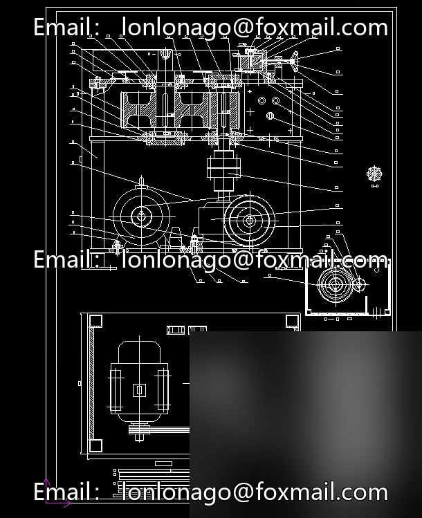
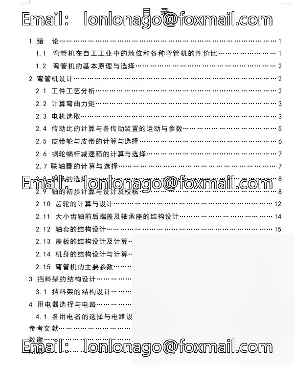
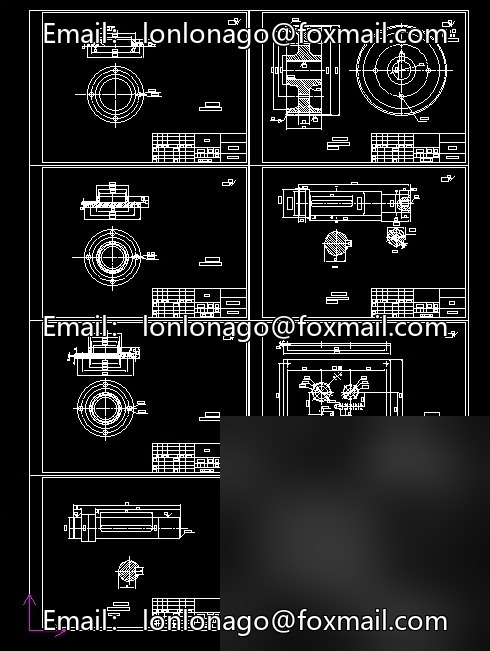
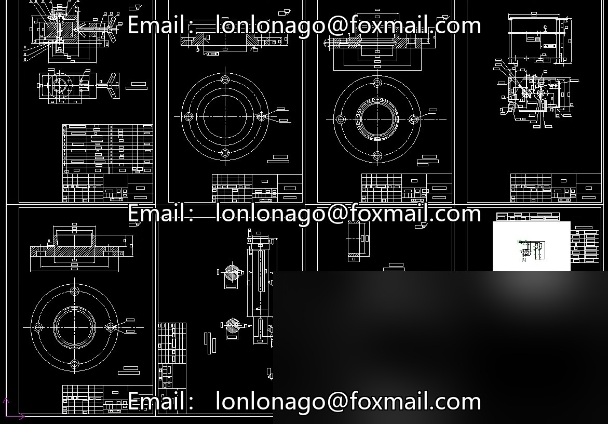

# Automatic bending machine design bending machine design

## Body

Auto bend machine design; bend machine design. This paper presents the device design and control circuit design for the auto bend machine, which can be composed of the machine body, motor, speed reduction mechanism, material stop mechanism, electrical control mechanism, etc.
450 Specific reference to the table of contents in the figures and the relevant CAD figures.

The design covers the design of automatic benders, their control circuits, and the device composed of a body, motor, reducing mechanism, stops, and electrical control components; reference the diagram directory and related CAD drawings, along with specific catalog and content references.

<!-- AI_ENRICHED -->

## Images

## Payment

Here is a pay link on Stripe ( https://buy.stripe.com/3cs8yP7sY87d0vu9AB ). Please contact me lonlonago@foxmail.com after funding $89, and I will send you a complete data files , thank you!

